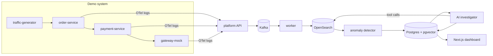

# AI Log Analyzer & Incident Assistant

An AI-assisted observability and incident-response platform: a small version of Datadog + PagerDuty
with an AI investigator. It ingests logs from running services, detects when something breaks, and uses
an LLM to find the probable root cause. Every claim is backed by a log or metric query that the backend
re-runs to check.

**Status:** Weeks 1 to 3 of 6 done.
- The demo services emit logs into the platform: Kafka, then a worker, then OpenSearch.
- Logs can be searched by service, level, text and trace ID.
- Per-minute metrics feed an EWMA anomaly detector, which opens incidents linked to recent deploys.
  The AI investigator is next. See [docs/PROGRESS.md](docs/PROGRESS.md).

## Quick start

Requires Node.js 20+ and Docker.

```bash
cp .env.example .env
npm run setup                        # npm install + Docker stack + database migration
npm run dev:all                      # services :4001-4003, platform API :4000, worker
npm run traffic -- --rps 10          # in a second terminal
```

Wait about 5 minutes so the detector learns a baseline, then break something:

```bash
curl -X PUT localhost:4002/admin/faults/bad_deploy -H 'content-type: application/json' -d '{}'
curl localhost:4000/api/v1/incidents?status=open      # an incident opens about 75 s later
curl localhost:4000/api/v1/incidents/INC-1            # timeline: anomalies + the 1.5.0 deploy
curl -X POST localhost:4002/admin/faults/reset        # roll back; the incident auto-resolves
```

Kafka topics are visible in Redpanda Console at http://localhost:8080.

Other commands:

| Command | What it does |
|---|---|
| `npm test` | Unit tests (Vitest) |
| `npm run typecheck` | `tsc --noEmit` in every workspace |
| `npm run traffic -- --help` | Traffic generator options (steady rate, bursts) |
| `npm run infra:up` / `infra:down` | Redpanda, OpenSearch, Postgres/pgvector in Docker |
| `npm run dev:platform` | Platform API + worker only |
| `npm run db:migrate` | Apply Prisma schema changes |
| `npm run docs:postman` | Rebuild the Postman collection |
| `LOG_FORMAT=json npm run dev:services` | Print raw OTel log records |

## Documentation

| Doc | Contents |
|---|---|
| [docs/PROJECT_FLOW.md](docs/PROJECT_FLOW.md) | How data moves through the system, with diagrams |
| [docs/CODEBASE.md](docs/CODEBASE.md) | Code layout, design decisions, conventions, how to extend |
| [docs/API.md](docs/API.md) | Every endpoint, request and response |
| [docs/FAULTS.md](docs/FAULTS.md) | The failure scenarios, their symptoms and measured results |
| [docs/PROGRESS.md](docs/PROGRESS.md) | Weekly plan, checklist and work log |
| [docs/postman/](docs/postman/) | Postman collection + local environment |

## Architecture



## Tech stack

TypeScript everywhere. The stack:

- Node.js + Express services
- OpenTelemetry for logs and traces
- Kafka (Redpanda locally) between ingestion and processing
- OpenSearch for logs
- PostgreSQL + Prisma + pgvector for incidents and runbook search
- Zod for validation
- Next.js with CSS Modules for the dashboard
- Vitest, Testcontainers and k6 for testing
- Docker Compose and GitHub Actions for setup and CI

## Results so far

| Metric | Target | Measured |
|---|---|---|
| End-to-end lag (event to indexed) | under 5 s | p50 546 ms, p95 1.0 s (10 orders/s) |
| Time to detect (fault to incident) | under 2 min | 56.7 s (gateway timeout), 74.5 s (bad deploy) |
| Ingestion throughput | 5,000 events/s | Week 6 (k6) |
| Ingestion latency p99 | under 50 ms | Week 6 (k6) |
| Root-cause accuracy | 8 of 10 | Week 5 (eval harness) |
