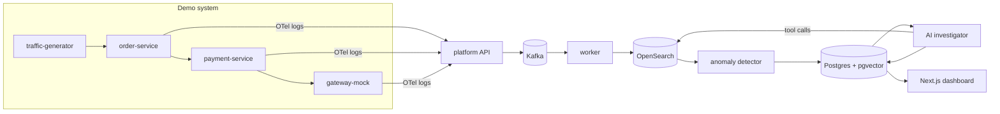

# AI Log Analyzer & Incident Assistant

An AI-assisted observability and incident-response platform: a small version of Datadog + PagerDuty
with an AI investigator. It ingests logs from running services, detects when something breaks, and uses
an LLM to find the probable root cause. Every claim is backed by a log or metric query that the backend
re-runs to check.

**Status:** Week 1 of 6 done. The demo services, fault injection and traffic generator work.
The platform (ingestion, detection, AI) comes next. See [docs/PROGRESS.md](docs/PROGRESS.md).

## Quick start

Requires Node.js 20+. Docker is only needed from Week 2.

```bash
npm install
npm run dev:services                 # order :4001, payment :4002, gateway :4003
npm run traffic -- --rps 10          # in a second terminal
```

Break something and watch the logs:

```bash
curl -X PUT localhost:4002/admin/faults/bad_deploy -H 'content-type: application/json' -d '{}'
curl -X POST localhost:4002/admin/faults/reset
```

Other commands:

| Command | What it does |
|---|---|
| `npm test` | Unit tests (Vitest) |
| `npm run typecheck` | `tsc --noEmit` in every workspace |
| `npm run traffic -- --help` | Traffic generator options (steady rate, bursts) |
| `npm run infra:up` / `infra:down` | Redpanda, OpenSearch, Postgres/pgvector in Docker |
| `npm run docs:postman` | Rebuild the Postman collection |
| `LOG_FORMAT=json npm run dev:services` | Print raw OTel log records |

## Documentation

| Doc | Contents |
|---|---|
| [docs/PROJECT_FLOW.md](docs/PROJECT_FLOW.md) | How data moves through the system, with diagrams |
| [docs/CODEBASE.md](docs/CODEBASE.md) | Code layout, design decisions, conventions, how to extend |
| [docs/API.md](docs/API.md) | Every endpoint, request and response |
| [docs/FAULTS.md](docs/FAULTS.md) | The failure scenarios, their symptoms and measured results |
| [docs/PROGRESS.md](docs/PROGRESS.md) | Weekly plan, checklist and work log |
| [docs/postman/](docs/postman/) | Postman collection + local environment |

## Architecture



## Tech stack

TypeScript everywhere. The stack:

- Node.js + Express services
- OpenTelemetry for logs and traces
- Kafka (Redpanda locally) between ingestion and processing
- OpenSearch for logs
- PostgreSQL + Prisma + pgvector for incidents and runbook search
- Zod for validation
- Next.js with CSS Modules for the dashboard
- Vitest, Testcontainers and k6 for testing
- Docker Compose and GitHub Actions for setup and CI

## Results

To be measured in Week 6: ingestion throughput, p99 ingest latency, end-to-end lag, time to detect,
root-cause accuracy, unsupported-claim rate, cost per investigation.
