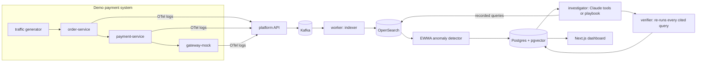

# AI Log Analyzer & Incident Assistant

An AI-assisted observability and incident-response platform: a small version of Datadog + PagerDuty
with an AI investigator. It ingests logs from running services, detects when something breaks, and finds
the probable root cause. Every claim it makes is backed by a log or metric query that the backend re-runs
to check before anyone sees it.

**Status:** MVP complete (6 of 6 weeks). See [docs/PROGRESS.md](docs/PROGRESS.md).

## Results

All numbers are measured on a laptop with the Docker stack in this repo. Method and raw output:
[docs/EVAL.md](docs/EVAL.md) and [docs/LOADTEST.md](docs/LOADTEST.md).

| Metric | Target | Measured |
|---|---|---|
| Root-cause accuracy (top hypothesis, 10 fault scenarios) | 8 of 10 | RESULT_ACCURACY |
| False incidents in the control scenario | none | RESULT_CONTROL |
| Time to detect (fault to incident) | under 2 min | RESULT_TTD |
| Unsupported claims rejected by the verifier | under 5% | RESULT_CLAIMS |
| Ingestion throughput | 5,000 events/s | RESULT_THROUGHPUT |
| Ingestion latency p99 (API returns 202) | under 50 ms | RESULT_P99 |
| End-to-end lag (event to indexed) | under 5 s | p50 546 ms, p95 1.0 s |
| Fallback works with the LLM unavailable | summary still shown | Yes: every eval investigation ran on the rule-based fallback (no API key) and produced a verified result |
| Cost per investigation | logged | $0 (rule-based); LLM cost is logged per investigation once a key is set |
| Logs lost with OpenSearch down for 40 s | 0 | 0 (5,471 redelivered duplicates dropped by event id) |

## How it works



1. **Ingest.** Services send OpenTelemetry-style logs in batches. The API validates them, puts them on
   Kafka and returns 202. A worker indexes them into OpenSearch, storing each event once by its id.
   Bad records go to a dead-letter topic.
2. **Detect.** Every 15 s the detector computes each service's per-minute error rate, p95 latency and
   heap from the logs. It compares them with an EWMA baseline (z-score plus a minimum change) and
   groups anomalies into incidents, with recent deploys on the timeline.
3. **Investigate.** With an Anthropic API key, a tool-calling Claude agent queries logs, metrics,
   traces, deploys, runbooks and past incidents. Without one (or if it fails), a rule-based playbook
   runs. Each claim cites the recorded query it came from and a checkable condition.
4. **Verify.** The backend re-runs each cited query and keeps only claims whose condition holds.
   Runbooks are never accepted as evidence. Hypotheses are ranked, with no invented confidence numbers.
5. **Show.** The dashboard lists incidents, their timeline, verified hypotheses with evidence, the
   queries that were run, and service health charts.

## Quick start

Requires Node.js 20+ and Docker.

```bash
cp .env.example .env                 # optional: add ANTHROPIC_API_KEY for the LLM investigator
npm run setup                        # npm install + Docker stack + database migration
npm run dev:all                      # services :4001-4003, API :4000, worker, dashboard :3000
npm run traffic -- --rps 10          # second terminal
```

Open http://localhost:3000 and wait about 5 minutes for a baseline. Then break something:

```bash
curl -X PUT localhost:4002/admin/faults/bad_deploy -H 'content-type: application/json' -d '{}'
```

An incident opens about 75 s later and is investigated 30 s after that. Roll back with
`curl -X POST localhost:4002/admin/faults/reset`. A full walkthrough is in [docs/DEMO.md](docs/DEMO.md).

| Command | What it does |
|---|---|
| `npm test` / `npm run typecheck` | 59 unit tests / strict TypeScript in every workspace |
| `npm run eval` | Runs all fault scenarios end to end and scores root-cause accuracy |
| `npm run loadtest` | k6 (in Docker) load test of log ingestion |
| `npm run infra:up` / `infra:down` | Redpanda, OpenSearch, Postgres/pgvector |
| `npm run db:migrate` | Apply Prisma schema changes |
| `npm run docs:postman` | Rebuild the Postman collection |

## Documentation

| Doc | Contents |
|---|---|
| [docs/PROJECT_FLOW.md](docs/PROJECT_FLOW.md) | How data moves through the system, with diagrams |
| [docs/CODEBASE.md](docs/CODEBASE.md) | Code layout, design decisions, conventions, how to extend |
| [docs/API.md](docs/API.md) | Every endpoint, request and response |
| [docs/FAULTS.md](docs/FAULTS.md) | The failure scenarios, their symptoms and measured results |
| [docs/EVAL.md](docs/EVAL.md) | Root-cause accuracy eval: method and results |
| [docs/LOADTEST.md](docs/LOADTEST.md) | Ingestion load test: method and results |
| [docs/DEMO.md](docs/DEMO.md) | 5-minute demo script |
| [docs/PROGRESS.md](docs/PROGRESS.md) | Weekly plan, checklists and work log |
| [docs/runbooks/](docs/runbooks/) | Runbooks the investigator searches |
| [docs/postman/](docs/postman/) | Postman collection + local environment |
| [graphify-out/](graphify-out/) | Knowledge graph of the codebase (open `graph.html`) |

## Tech stack

- **Language:** TypeScript everywhere (npm workspaces).
- **Services and API:** Node.js + Express. OpenTelemetry for trace propagation, Zod for validation.
- **Pipeline and storage:** Kafka (Redpanda locally) via KafkaJS, OpenSearch for logs, PostgreSQL +
  Prisma + pgvector for incidents, investigations and runbook search.
- **AI:** Claude Opus 5.5 through the Anthropic SDK (manual tool-calling loop, prompt caching,
  server-side refusal fallback).
- **Dashboard:** Next.js 16 with CSS Modules (no Tailwind) and Recharts.
- **Testing and tooling:** Vitest, k6, Docker Compose, GitHub Actions.

## Resume line

> Built an OpenTelemetry-compatible incident platform (Node.js, Kafka, OpenSearch, PostgreSQL)
> ingesting RESULT_THROUGHPUT_SHORT; anomaly detection opens incidents within RESULT_TTD_SHORT of an
> injected fault; the investigator named the correct root cause in RESULT_ACCURACY_SHORT fault scenarios,
> with every cited figure verified against the logs.
