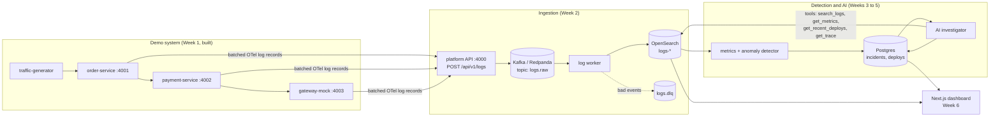
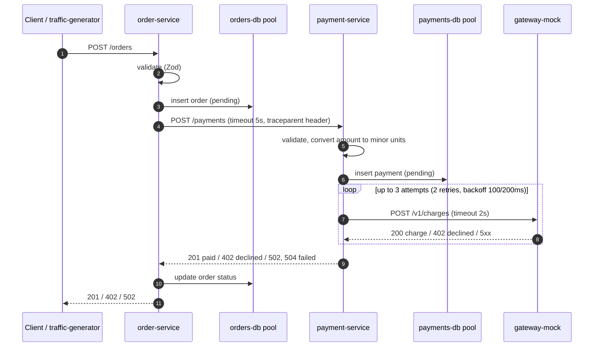
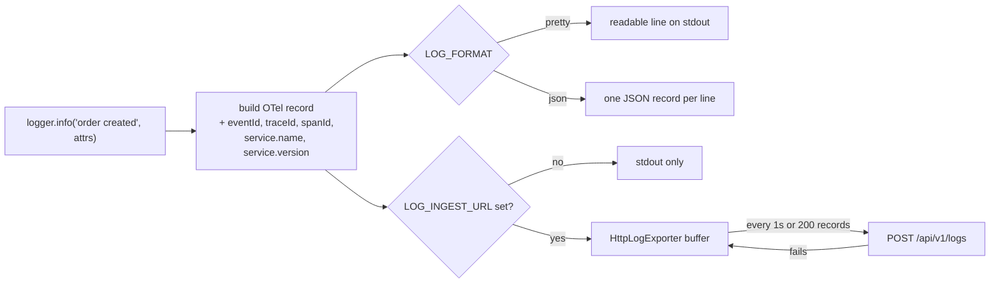
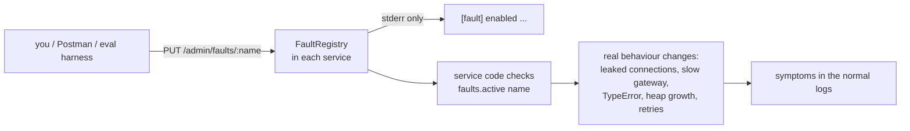
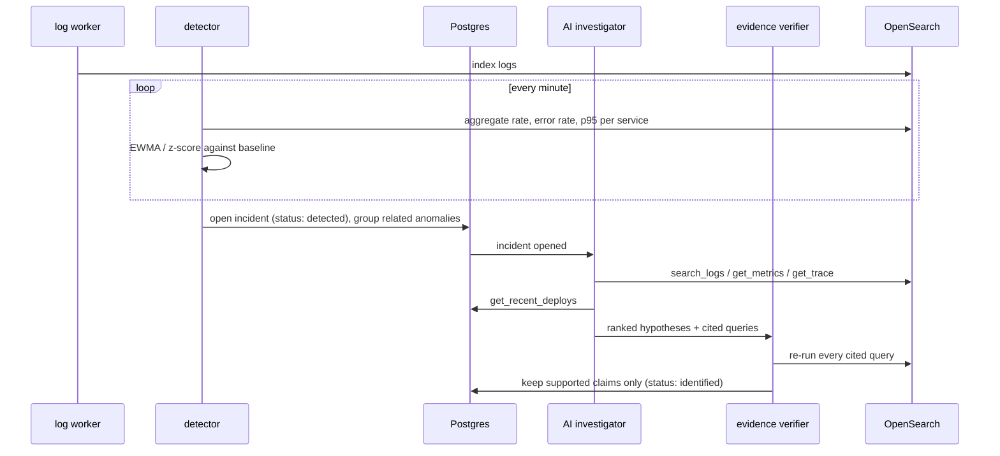

# Project flow

How data moves through the system: what exists today and what each week adds.
Diagrams use Mermaid, which renders on GitHub and in VS Code's Markdown preview.

**Built so far:** Week 1 (demo services, fault injection, traffic generator, infra definition).

## 1. The big picture



The API only validates logs and hands them to Kafka, so ingestion stays fast even when analysis is slow.

## 2. One order, end to end (built)



Every step writes a log record. All records from one order share a trace ID, because OpenTelemetry's
HTTP and fetch instrumentation passes the `traceparent` header between services. In Week 2 the trace view
uses this ID to put one order's logs from three services in order.

Example from a real run (trace `c2ab3c5a`):

```text
[order-service@2.1.0]   order created order.id=ord_98f2... order.total=39.98 order.currency=EUR
[gateway-mock@3.2.0]    charge authorised payment.id=pay_a963... charge.amount_minor=3998
[gateway-mock@3.2.0]    POST /v1/charges 200 97.6ms
[payment-service@1.4.2] payment succeeded payment.id=pay_a963... payment.attempts=1
[payment-service@1.4.2] POST /payments 201 209.6ms
[order-service@2.1.0]   order paid order.id=ord_98f2...
[order-service@2.1.0]   POST /orders 201 322.2ms
```

## 3. How a log record is produced (built)



Three kinds of records reach the platform:

| Record | Written by | Used for |
|---|---|---|
| Request log: `POST /orders 201 322.2ms` with `http.route`, `http.response.status_code`, `duration_ms` | `requestLogger` middleware, once per request | Request rate, error rate, p95 latency (Week 3) |
| Business and error events: `payment failed after 3 gateway attempts` | Service code | Root-cause evidence |
| Process stats every 15 s: heap, RSS, event-loop delay, DB pool usage | `startProcessMonitor` | Resource signals (leaks, pool exhaustion) |

The exporter never throws into the service. If the platform is down it keeps up to 10,000 records,
drops the oldest beyond that, and prints one warning a minute to stderr.

## 4. Fault injection (built)



Fault changes are never written to the log stream, so the investigator only sees symptoms.
Details for each fault are in [FAULTS.md](FAULTS.md).

## 5. Incident flow (Weeks 3 to 4, planned)



If the LLM call fails (timeout, retries used up, circuit open), a rule-based summary is stored instead.
