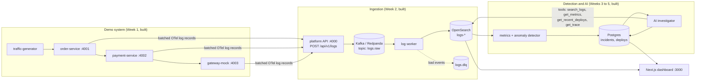
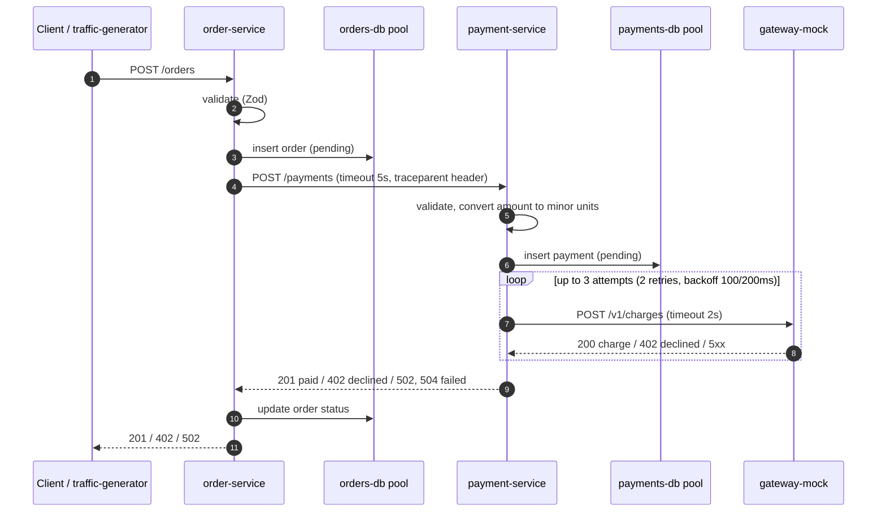
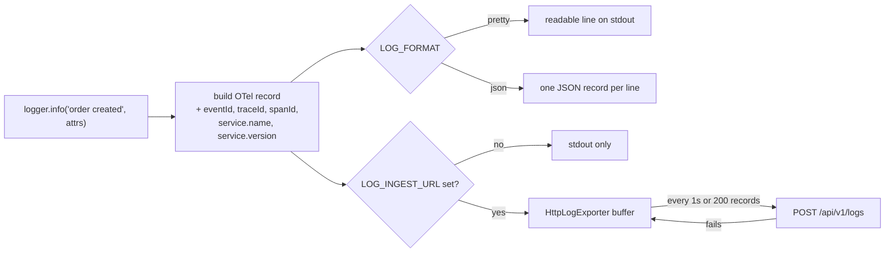
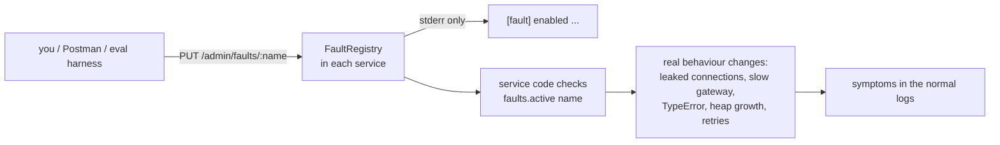
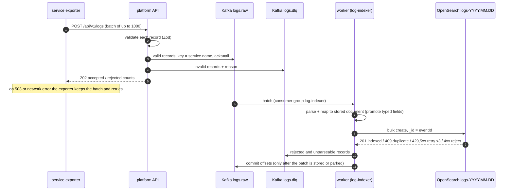
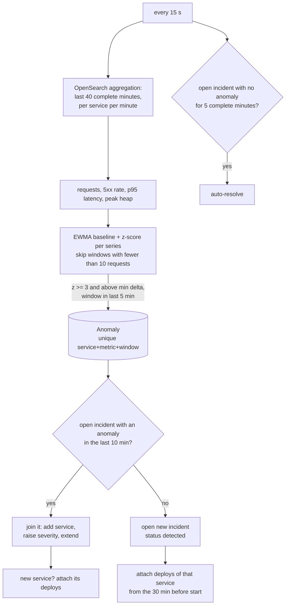
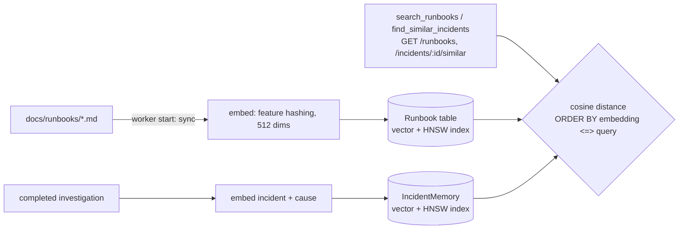

# Project flow

How data moves through the system: what exists today and what each week adds.
Diagrams use Mermaid, which renders on GitHub and in VS Code's Markdown preview.

**Built:** all six weeks.
- Demo services and faults.
- The ingestion pipeline (API, Kafka, worker, OpenSearch), log search and trace view.
- Per-minute metrics, anomaly detection, deploy tracking and incidents.
- The AI investigator with evidence verification and a rule-based fallback.
- Runbook and past-incident search (pgvector).
- The eval harness, the k6 load test and the Next.js dashboard.

## 1. The big picture



The API only validates logs and hands them to Kafka, so ingestion stays fast even when analysis is slow.

## 2. One order, end to end (built)



Every step writes a log record. All records from one order share a trace ID, because OpenTelemetry's
HTTP and fetch instrumentation passes the `traceparent` header between services. The trace view
(`GET /api/v1/traces/:traceId`) uses this ID to put one order's logs from three services in order.

Example from a real run (trace `c2ab3c5a`):

```text
[order-service@2.1.0]   order created order.id=ord_98f2... order.total=39.98 order.currency=EUR
[gateway-mock@3.2.0]    charge authorised payment.id=pay_a963... charge.amount_minor=3998
[gateway-mock@3.2.0]    POST /v1/charges 200 97.6ms
[payment-service@1.4.2] payment succeeded payment.id=pay_a963... payment.attempts=1
[payment-service@1.4.2] POST /payments 201 209.6ms
[order-service@2.1.0]   order paid order.id=ord_98f2...
[order-service@2.1.0]   POST /orders 201 322.2ms
```

## 3. How a log record is produced (built)



Three kinds of records reach the platform:

| Record | Written by | Used for |
|---|---|---|
| Request log: `POST /orders 201 322.2ms` with `http.route`, `http.response.status_code`, `duration_ms` | `requestLogger` middleware, once per request | Request rate, error rate, p95 latency (Week 3) |
| Business and error events: `payment failed after 3 gateway attempts` | Service code | Root-cause evidence |
| Process stats every 15 s: heap, RSS, event-loop delay, DB pool usage | `startProcessMonitor` | Resource signals (leaks, pool exhaustion) |

The exporter never throws into the service. If the platform is down it keeps up to 10,000 records,
drops the oldest beyond that, and prints one warning a minute to stderr.

## 4. Fault injection (built)



Fault changes are never written to the log stream, so the investigator only sees symptoms.
Details for each fault are in [FAULTS.md](FAULTS.md).

## 5. Ingestion pipeline (built)



- **Duplicates.** A record resent by the exporter, retried by the producer, or redelivered by Kafka after
  a worker crash has the same `eventId`, so OpenSearch keeps one copy. Verified: the same event posted
  3 times was stored once.
- **OpenSearch down.** The bulk call throws, the offset is not committed, and Kafka redelivers the batch
  when OpenSearch is back.
- **Measured lag** (event timestamp to indexed): p50 546 ms, p95 1007 ms at 10 orders/s. Most of it is the
  services' 1-second exporter flush interval.

## 6. Detection and incidents (built)



Timing: a fault that starts at minute *m* shows in window *m*. That window is complete at *m+1:00*,
settles for 15 s, and the next detector tick (at most 15 s later) opens the incident. That is about
75 to 90 s after the fault, under the 2-minute target.

Incident lifecycle: `detected -> investigating -> identified -> resolved` (also `identified -> investigating`).
Changes come from `PATCH /api/v1/incidents/:id` or auto-resolve. Every change is a timeline event.

## 7. Investigation flow (built)

```mermaid
sequenceDiagram
  autonumber
  participant L as worker: investigator loop
  participant DB as Postgres
  participant AI as Claude (tool calling)
  participant LG as evidence ledger
  participant T as tools (OpenSearch, Postgres, pgvector)
  participant V as verifier

  L->>DB: new open incident, detected 30 s ago, not investigated
  L->>DB: status detected -> investigating
  alt LLM key set and circuit closed
    loop up to 14 turns, 4 min deadline
      L->>AI: incident context + tools (system prompt and tools cached)
      AI-->>L: tool_use: summarize_errors / get_metrics / search_logs / get_trace / get_recent_deploys / search_runbooks / find_similar_incidents
      L->>LG: run each call, record exact params as q1, q2, ...
      LG->>T: query
      T-->>AI: result tagged with its query_id
    end
    AI-->>L: submit_findings (strict schema): ranked hypotheses, each claim = query_id + check
  else no key, circuit open, LLM error, or nothing verifiable
    L->>LG: rule-based playbook: summarize_errors, get_recent_deploys, get_metrics
    LG->>T: query
    L->>L: match known failure patterns, rank, attach closest runbook
  end
  L->>V: findings + ledger
  V->>LG: re-run every cited query with the same params
  V->>V: apply each check; drop failed or invented claims; drop hypotheses with no support
  V->>DB: Investigation (verified hypotheses, rejected claims, queries, tokens, cost)
  L->>DB: incident summary, status investigating -> identified, timeline event
  L->>DB: IncidentMemory (embedding) for future similar-incident search
```

**What makes a claim verifiable.** Every piece of evidence names a `query_id` from the ledger and one of
four checks: `log_count_at_least`, `log_text_present`, `metric_threshold` or `deploy_present`. The
verifier runs that same query again and evaluates the check on the fresh result. Three cases are
rejected and listed under "rejected claims":
- a claim that cites a query that never ran
- a claim whose check fails on the re-run
- a claim that cites a runbook or a past incident (those are context, not evidence about this incident)

**Resilience.**
- Each LLM request has a 90 s timeout, and the SDK retries 429 and 5xx twice with backoff.
- A circuit breaker opens after 3 consecutive provider failures and refuses LLM calls for 2 minutes;
  after that, one trial call is allowed.
- The agent stops after 14 turns or 4 minutes.
- A refusal from the model's safety classifier is retried on a fallback model server-side (`fallbacks: "default"`).
- In every failure case the rule-based playbook runs, so an incident always gets a verified answer or an explicit "no verified cause".

**Cost.** Token usage is summed per investigation and priced (Claude Opus 5.5: $4 input, $20 output,
$0.20 cache read per million tokens). The stable system prompt and tool list are prompt-cached across
turns. Effort defaults to `medium` (`LLM_EFFORT`).

## 8. Knowledge base (built)



Embeddings are computed locally: words and word pairs are hashed into 512 signed buckets. This needs no
model download and no external API. It is lexical, which works because runbooks, error messages and
incident summaries share vocabulary. A neural embedder can replace `embed()` without changing storage
or queries.

## 9. Eval and load test (built)

- `npm run eval`:
  1. Starts steady traffic and waits 6 minutes for a baseline.
  2. For each scenario: injects the faults, waits for an incident that started after the injection,
     waits for its investigation, and scores the top hypothesis (category and service) against the
     known cause.
  3. Removes the faults, resolves leftovers and cools down 7 minutes.

  Reports go to `eval/results/`; see [EVAL.md](EVAL.md).
- `npm run loadtest`: k6 (in Docker) sends batches of 100 records to `POST /api/v1/logs` at a rising
  request rate and reports events/s and the latency of 202 responses. See [LOADTEST.md](LOADTEST.md).
